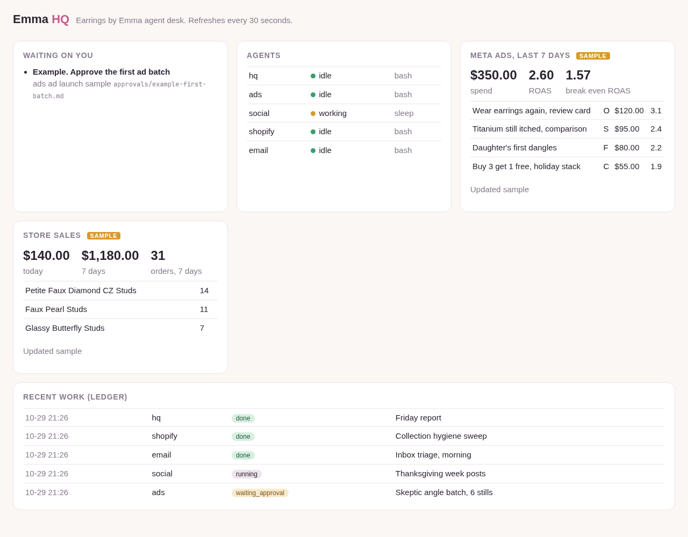

# Emma HQ

**An AI agent desk for Earrings by Emma.** Six Claude Code agents work side by side on your computer: a manager called **HQ**, and specialists for **ads** (with a research partner), **social**, **Shopify** and **email**. Each one has its own workspace and its own folder; `docs/layout.md` shows the map. You talk to HQ. HQ hands work to the right specialist, checks it, and brings you only finished work and clear questions.

Nothing is ever posted, sent, launched, spent or changed in your store without your yes. The agents prepare everything and then ask.

Built for you by ThinkSocial.

## What you get

* **HQ, the manager** (`CLAUDE.md`). Knows who does what, checks every agent before giving it work, never answers a question meant for you, and reports in plain language.
* **Four specialists,** each in its own folder with its own instructions:
  * `ads/` angles from your real reviews, a weekly batch of ad images built from your real product photos (no AI image credits), a quality check before you see anything, and a variety score for each batch.
  * `social/` a content calendar, a post queue in files, and five content pillars drawn from what your customers say.
  * `shopify/` store checkups, product and collection tidy ups, and daily sales numbers. Reads first, changes nothing without your OK.
  * `email/` sorts the inbox, drafts replies and Klaviyo campaigns. Never sends.
* **Memory** (`memory/`). Facts and rules every agent reads at the start of every session: your story, your offers, the claims you can make, your customers' words, your brand look. Agents add to it when you teach them something. See `docs/memory.md`.
* **A work ledger** (`scripts/ledger`). A record of every job: who did it, what was asked, what came out. See `docs/ledger.md`.
* **Loops** (`docs/loops.md`). The weekly ad batch, the social week, inbox triage and a Friday report, each started with one command.
* **A dashboard** (`scripts/dashboard.py`). One page showing what is waiting on you, what each agent is doing, ad spend and ROAS, store sales and recent work. See `docs/dashboard.md`.



## Setting up, step by step

You need a Windows 10 or 11 computer and a Claude account (Pro or Max plan) for Claude Code. Allow about 30 minutes.

### 1. Install WSL (Ubuntu on Windows)

Open **PowerShell as Administrator** (Start menu, type PowerShell, right click, Run as administrator) and run:

```
wsl --install -d Ubuntu
```

Restart when asked. Ubuntu opens and asks you to pick a username and password. Remember the password; Ubuntu asks for it when installing software.

From now on, every command goes in the **Ubuntu** window (Start menu, type Ubuntu).

### 2. Get Emma HQ

```
sudo apt-get update && sudo apt-get install -y git
cd ~
git clone https://github.com/thinksocialcontext/emma-hq.git
cd emma-hq
```

### 3. Run setup

```
./setup.sh
```

Setup checks what is installed and asks before installing each piece:

* basic tools: git, curl, Python, tmux, ImageMagick, jq
* Node.js LTS
* Claude Code (the official installer from claude.ai)
* GitHub CLI (optional)
* herdr (optional and recommended; free and open source). If you skip it, tmux does the same job.
* the brand fonts for ad images

It also makes your private `.env` file, copies the starter memories into `memory/`, and runs a quick self test. You can run it again any time; it only does what is still missing. To see what is installed without changing anything: `./setup.sh --check`.

### 4. Sign in to Claude Code

Open a new Ubuntu window and run `claude` once. Sign in with your Claude account, then type `/exit`.

### 5. Connect your tools (when you are ready)

Each one is optional. Start with none and add them as you go.

* **Shopify:** in Claude Code, add the Shopify connector, or create a custom app in Shopify (Settings, Apps and sales channels, Develop apps) with **read** scopes and put its token in `.env`.
* **Email:** add the Gmail (or Outlook) connector in Claude Code. The email agent only reads and makes drafts.
* **Meta ads numbers:** a read only token in `.env`, or export a report and ask the ads agent to load it.
* **Klaviyo:** a private key with read scopes in `.env`.

Keys only ever go in `.env`. Never paste a key into a chat with an agent.

## First run

```
scripts/hq start
```

This opens one workspace per area, each rooted at its own folder:

| herdr workspace / tab | Folder | Agent |
| --- | --- | --- |
| HQ | `./` | `hq` |
| Ads | `ads/` | `ads` |
| Ads / Research | `ads/research/` | `ads-research` |
| Social | `social/` | `social` |
| Shopify | `shopify/` | `shopify` |
| Email | `email/` | `email` |

The full map, with what each agent writes, is in `docs/layout.md`.

* **With herdr:** run `herdr` first, then `scripts/hq start` inside it. You will see five workspaces: HQ, Ads, Social, Shopify and Email. Ads has a second tab called Research.
* **With tmux:** run `scripts/hq attach` to see them. There is one window per agent. Press **Ctrl+b** then a number (0 to 5) to switch agents. Press **Ctrl+b** then **d** to step away and leave them running.

The first time each agent starts, Claude Code asks whether you trust the folder. Answer yes for each one.

Go to the **hq** agent and type:

```
/status
```

In a second Ubuntu window, start the dashboard and open http://localhost:8765 in your browser:

```
python3 scripts/dashboard.py
```

## Daily use

Talk to HQ in plain words. For example:

* "What needs me today?"
* "Plan next week's ads. Test the skeptic angle with the Petite Faux Diamond Studs."
* "Plan the social posts for Thanksgiving week."
* "Sort the inbox and draft replies."
* "Check the store for products missing from a collection."
* "Remember: we never post on Sundays."

Or use the shortcuts:

| Type this in HQ | It does |
| --- | --- |
| `/status` | what needs you, what is blocked, what finished |
| `/batch` | plans and builds this week's ad batch, checks it, asks you to approve |
| `/rate` | scores the variety of an ad batch on one contact sheet |
| `/social-week` | plans next week's posts into the queue, asks you to approve |
| `/triage` | sorts the inbox and drafts replies (never sends) |
| `/friday-report` | writes the weekly report |
| `/remember` | saves a fact or rule to memory |

### Approving things

When an agent needs a yes, it writes a file in `approvals/` and the dashboard shows it under **Waiting on you**. Read it, then tell HQ "approved" or "no, change this", or edit the file's `status:` line yourself. Agents act only on a clear yes to that exact item.

### Stopping for the day

Agents can keep running. To close them all (tmux): `scripts/hq stop`. With herdr, close the HQ, Ads, Social, Shopify and Email workspaces in herdr.

## Keeping your data private

* `.env` (your keys), `memory/`, `work/` (the ledger), `data/`, `approvals/`, reports, email drafts and ad images all stay on your computer and are ignored by git.
* The kit itself is public. Your copy holds your business: if you back it up to GitHub, push it to a new **private** repository of your own.

## For the curious

* `docs/layout.md` which workspace works in which folder
* `docs/memory.md` how agents remember
* `docs/ledger.md` the work record
* `docs/loops.md` the repeating jobs
* `docs/dashboard.md` the dashboard and its numbers
* `docs/herdr-and-tmux.md` how the agents run side by side
* `tests/run.sh` the self tests (`bash tests/run.sh`)

## License

MIT, see `LICENSE`. Copyright ThinkSocial.
