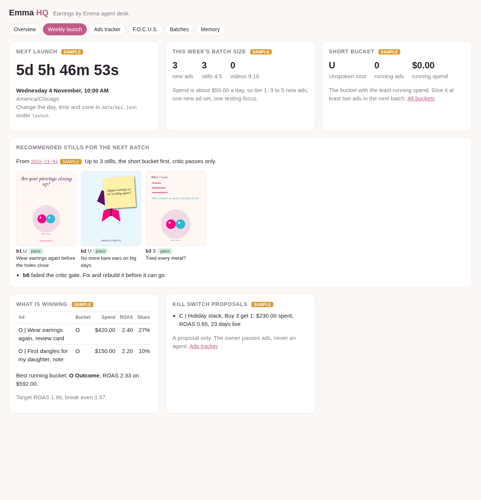
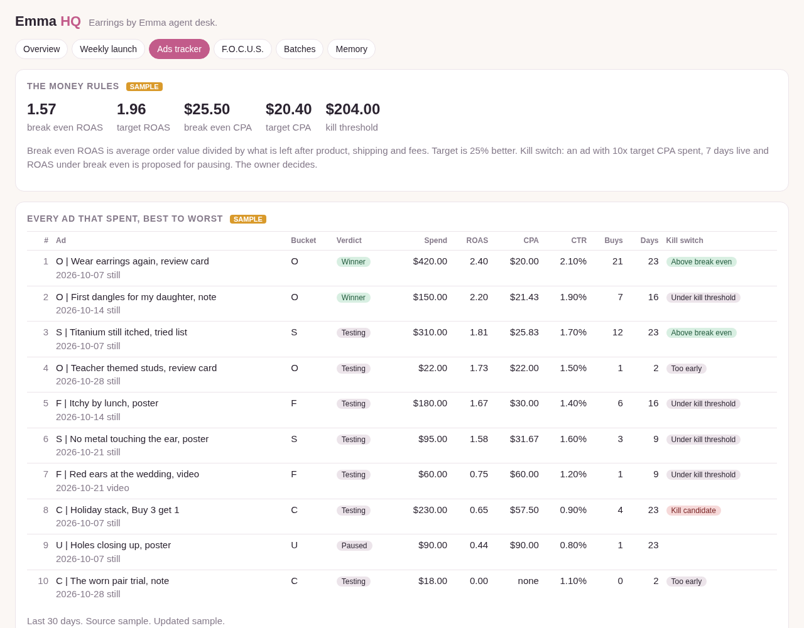
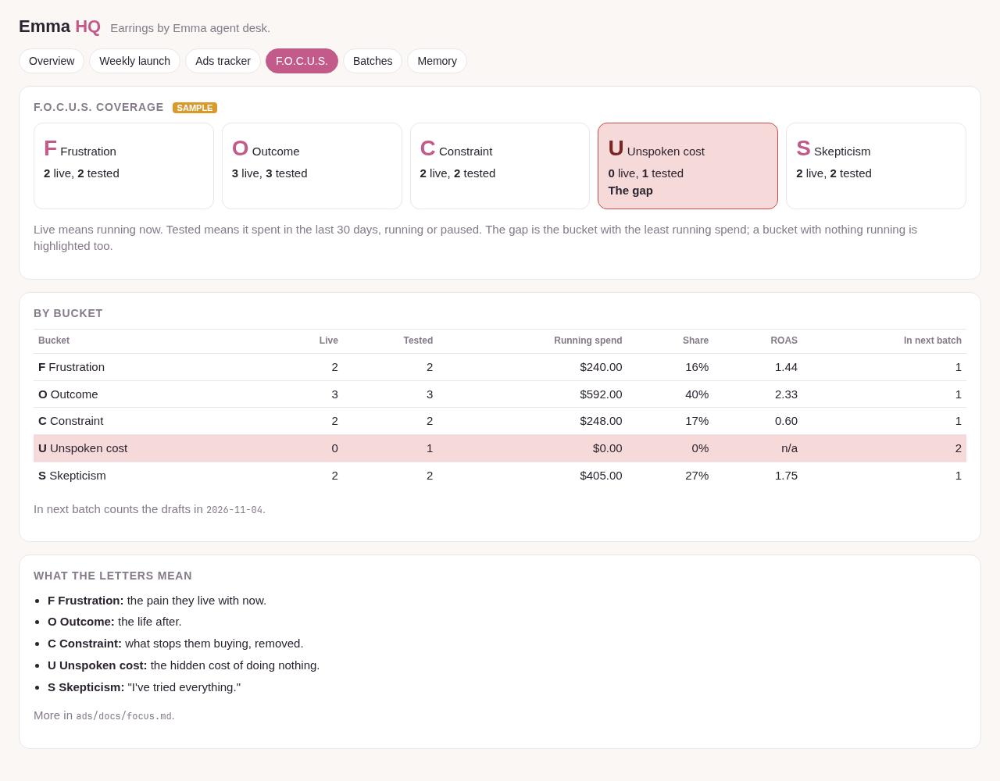
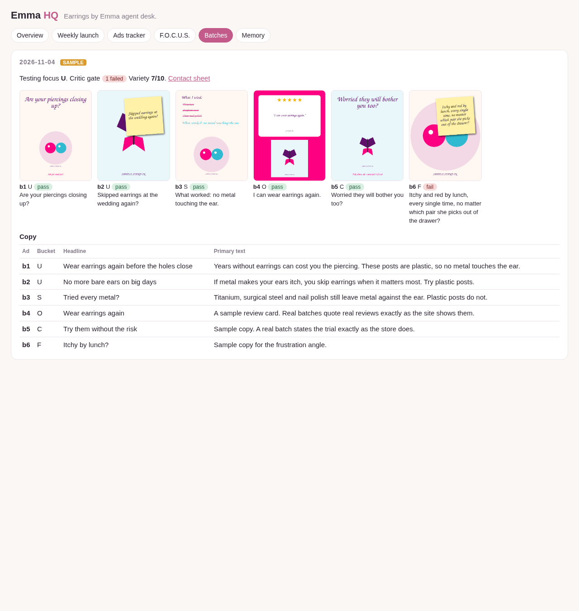
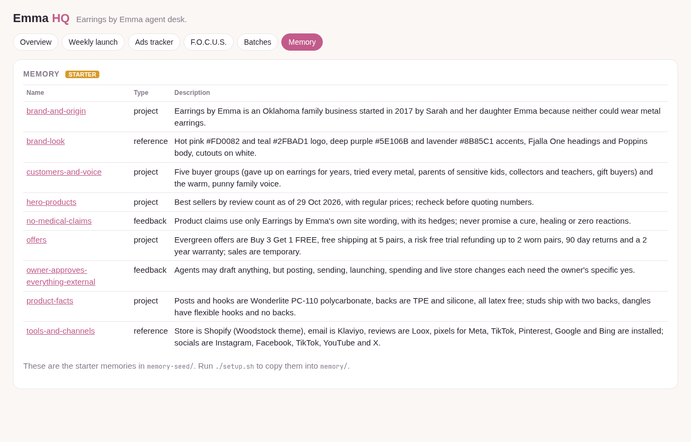
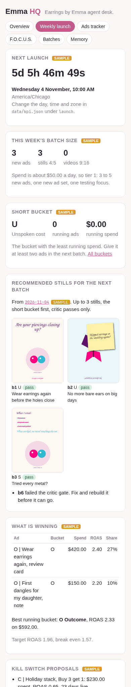

# The dashboard

A few pages on this computer that show what is going on. They work on a phone too.

```
python3 scripts/dashboard.py
```

Then open http://localhost:8765 in a browser (from Windows too: WSL forwards localhost). Stop it with Ctrl+C.


## The pages

The menu at the top switches between them.

* **Overview** (`/`): what is waiting on you (every file in `approvals/` with `status: waiting`), each agent and its state, Meta spend and ROAS, store sales, and the ledger's recent work.
* **Weekly launch** (`/launch`): a live countdown to your launch day and time, how many new ads this week's spend calls for, the recommended stills from the next batch in `ads/batches/`, what is winning, the short F.O.C.U.S. bucket, and kill switch proposals.
* **Ads tracker** (`/tracker`): every ad that spent in the last 30 days, best ROAS to worst, with spend, ROAS, CPA, CTR, purchases, days live and its kill switch flag. The top shows break even ROAS, target ROAS, break even CPA, target CPA and the kill threshold.
* **F.O.C.U.S.** (`/focus`): live and tested ads per bucket (Frustration, Outcome, Constraint, Unspoken cost, Skepticism), with the gap highlighted.
* **Batches** (`/batches`): every weekly batch, newest first, with its stills, copy, critic gate result and `/rate` variety score.
* **Memory** (`/memory`): every memory with its name, type and description. Click one to read it. Read only; teach the agents with `/remember`.

Until the agents write real files, every page shows the samples from `data/examples/` with a **SAMPLE** tag, and Memory shows the starter memories with a **STARTER** tag.

| Weekly launch | Ads tracker |
| --- | --- |
|  |  |
| **F.O.C.U.S.** | **Batches** |
|  |  |
| **Memory** | **Weekly launch on a phone** |
|  |  |

## The rules behind the numbers

All from `data/kpi.json`:

* **Break even CPA** = average order value minus cost per order (product, shipping and fees). It is what one sale can pay for ads.
* **Break even ROAS** = average order value / break even CPA.
* **Target ROAS** = break even ROAS x 1.25 (25% better). Change `target_uplift` to move it.
* **Target CPA** = break even CPA / 1.25.
* **Kill switch:** an ad that has spent **10x target CPA**, has been live **7 days or more**, and is still **under break even ROAS** is flagged "Kill candidate". It is a proposal for you; agents never pause ads.
* **Winner:** running, at least 3% of spend, and at or above target ROAS.
* **Short bucket:** the F.O.C.U.S. letter with the least running spend. The next batch should give it at least two ads.
* **Batch size:** from daily spend. Under $300 a day: 3 to 5 new ads. Under $2,000: 5 to 10. Above: 10 to 20. Roughly one ad per $100 a day, within the range.
* **Recommended stills:** from the newest batch that has not launched yet (no ad in `data/ads.json` carries its date). Stills that failed the critic gate are held back; the short bucket goes first.

### The launch countdown

`data/kpi.json` holds your launch day, time and time zone:

```
"launch": {"day": "Wednesday", "time": "10:00", "timezone": "America/Chicago"}
```

The default is Wednesday at 10am Central (Oklahoma). Use any name from the time zone list, for example `America/New_York`.

## Feeding it real numbers

* The **ads** agent writes `data/ads.json` with `ads/tools/meta_pull.py`, before each weekly batch and on `/status`. How to connect Meta: `docs/connect-meta.md`.
* The **shopify** agent writes `data/shopify.json` from the store (read only). How to connect Shopify: `docs/connect-shopify.md`.
* The owner fills `data/kpi.json` once (copy `data/examples/kpi.json`): average order value, product cost, shipping and fees per order, and the launch time.
* Batches come from `ads/batches/<date>/` (see `ads/batches/README.md`). The gallery reads `final/` stills, `copy.json`, `critic.md` (a pass or fail per ad id) and `diversity.md` (a line like `Overall: 7/10`).

The files in `data/`, `ads/batches/` and `memory/` are not committed to git.

### data/ads.json

```
{
  "updated": "2026-11-03 14:00 UTC",
  "source": "meta_api",            meta_api, ads_manager_csv or sample
  "window_days": 30,
  "currency": "USD",
  "spend_7d": 350.00,              account totals for 7 days (API only)
  "purchase_value_7d": 910.00,
  "ads": [
    {
      "id": "120000000000000001",  Meta ad id
      "name": "O | Wear earrings again, review card",
      "focus": "O",                F, O, C, U or S, from the ad name
      "batch": "2026-10-07",       from the ad set name
      "format": "still",           still or video
      "status": "active",          active or paused
      "spend": 420.00,             last 30 days
      "purchases": 21,
      "revenue": 1010.00,          purchase conversion value
      "roas": 2.40,                revenue / spend
      "cpa": 20.00,                spend / purchases, null with no purchase
      "ctr": 2.10,                 link click through rate, in percent
      "days_live": 23              days since the ad was created
    }
  ]
}
```

## Safety

* It listens on 127.0.0.1 only, so nobody else on the network can see it.
* It only reads. No page can change an ad, the store, a memory or a file.
* Images are served only from the batch folders' `final/` stills and `sheet.jpg`. Any other path, `..`, or a link pointing outside the folder gets "not found".

## Options

```
python3 scripts/dashboard.py --port 9000   # a different port
python3 scripts/dashboard.py --once        # print the data as JSON and exit
```
