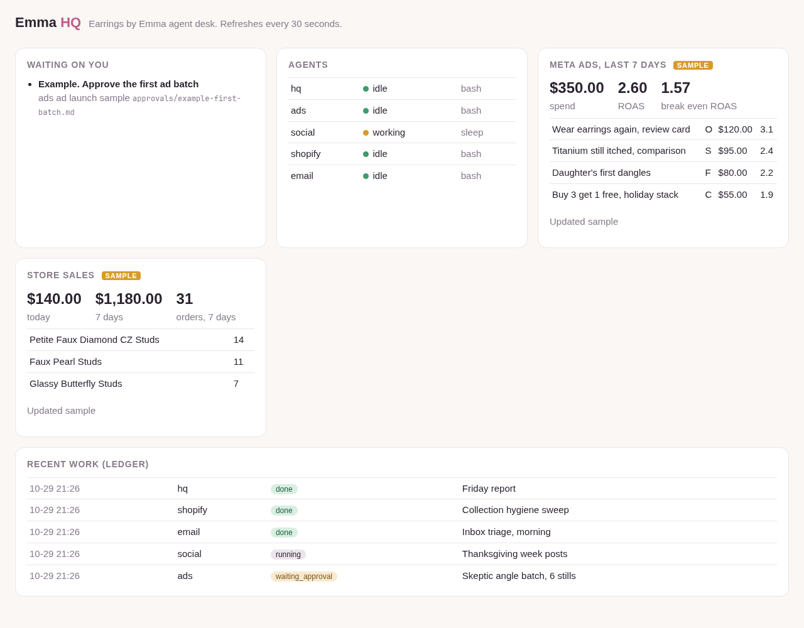

# The dashboard

One page on this computer that shows what is going on.

```
python3 scripts/dashboard.py
```

Then open http://localhost:8765 in a browser (from Windows too: WSL forwards localhost). Stop it with Ctrl+C.



## What it shows

* **Waiting on you:** every file in `approvals/` with `status: waiting`.
* **Agents:** each agent and its state (idle, working, blocked) from `scripts/hq list`.
* **Meta ads, last 7 days:** spend, ROAS, and break even ROAS from `data/ads.json` and `data/kpi.json`.
* **Store sales:** today, 7 days, orders and top products from `data/shopify.json`.
* **Recent work:** the ledger.

Until the agents write real files into `data/`, the page shows the samples from `data/examples/` with a **SAMPLE** tag.

## Feeding it real numbers

* The **shopify** agent writes `data/shopify.json` from the store (read only).
* The **ads** agent writes `data/ads.json` from a Meta Ads export or the Marketing API.
* The owner fills `data/kpi.json` once (copy `data/examples/kpi.json`): average order value, product cost, shipping and fees per order. Break even ROAS is average order value divided by (average order value minus cost per order). Target ROAS is 25% better.

The files in `data/` are not committed to git.

## Options

```
python3 scripts/dashboard.py --port 9000   # a different port
python3 scripts/dashboard.py --once        # print the data as JSON and exit
```

It listens on 127.0.0.1 only, so nobody else on the network can see it.
